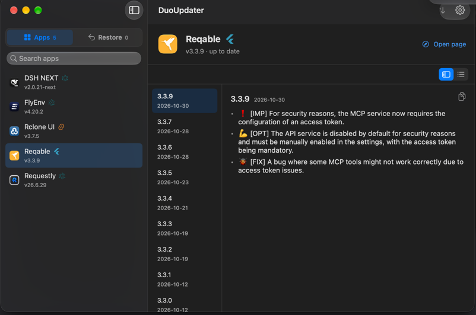

# Reqable

## 基本信息
- App: Reqable — Flutter 写的 HTTP/HTTPS 调试代理（抓包、改包、API 测试）
- Bundle ID: `com.reqable.macosx`
- 仓库: `reqable/reqable-app`（只用来发版；源码不开源）
- Team ID: `DXY5A5J7C4`（Developer ID Application: Shanghai Reqable Technology Co., Ltd.）；spctl: Notarized Developer ID
- 观测版本: 3.3.9（tag `3.3.9`、release 名 `v3.3.9`，资产 `reqable-app-macos-arm64.dmg`）；装机观测 3.3.7（`CFBundleVersion` = `229`，是 build 号不是 marketing 版本）；观测于 vmpal「macOS VM 1」（macOS 27.2）
- 自更新机制: **Sparkle，但没有 `SUFeedURL`**。bundle 里有 `Sparkle.framework`、`auto_updater.framework`（Flutter 的 Sparkle 包装）和 Info.plist 的 `SUPublicEDKey`，feed 地址是运行时传给 Sparkle 的，静态读不到。也没有 `app-update.yml`（不是 electron-builder 打的包）
- 分发: GitHub Releases；Homebrew cask `reqable`

## 覆盖矩阵

> ✓ = 已接入  ○ = 可接入(未实现)  ✗ = 已调查不可行  — = 不适用

|        | Sparkle | Homebrew | MAS | GitHub | VendorProbe |
|--------|---------|----------|-----|--------|-------------|
| stable | ✗       | —        | —   | ✓      | ○           |

- **Sparkle ✗**：没有 `SUFeedURL`，`SparkleAppcastSource` 无从下手
- **VendorProbe ○**：二进制里有 `/version/smart-appcast?version=` 这个路径和 `api.reqable.com` 主机，但 `https://api.reqable.com/version/smart-appcast?version=3.3.7` 回 404，`https://reqable.com/…` 回 567（反爬）。靠扫二进制猜地址正是 repo 反对的启发式，所以没用；改用厂商确实在发版的 GitHub
- **GitHub ✓**：cask 也从这里装，资产就在 release 里

## 覆盖清单
- **bundle id**：只有 `com.reqable.macosx`
- **Team**：3.3.7 与 3.3.9 的 dmg 都是 `DXY5A5J7C4`
- **tag 形状**：裸版本号 `3.3.9`；`v` 只在 release **名**里。所以 `versionPattern` 不能带 `v?` 以外的假设，这里钉成 `^([0-9]+\.[0-9]+…)$`
- **只有 Windows 的 release 会出现**：3.3.8 只有 `reqable-app-windows-x86_64.exe/.zip` 两个资产，**没有 macOS 资产**。`GitHubReleasesSource` 会向上最多跳过 5 个这样的 release 再放弃，所以这不会读成 `unknown`
- **资产**：macOS 那份文件名固定 `reqable-app-macos-arm64.dmg`
- **运行时形态**：菜单栏常驻，**没有窗口**；启动后自己监听 `*:9000`（抓包代理端口）和 `127.0.0.1:9016`，都以登录用户身份运行

## 更新检测
`GitHubReleaseRule`（`com-reqable-macosx` family），`owner: reqable`、`repo: reqable-app`，`versionPattern` 钉裸数字，`installAssetPattern` 钉 `^reqable-app-macos-arm64\.dmg$`。

## 一键安装
`installerKind: .dmg`。Team 闸 = 已装副本的 `DXY5A5J7C4`；GitHub 也为该资产发 `digest`（sha256），下载后先核对 digest 再走 Team 闸。

## Changelog
正文**按平台分节**：`### windows-macos-linux-android-ios` 是共用说明，后面是各平台单独一节，条目是厂商自己的 `- ❗ [IMP] …` / `- 🐞 [FIX] …` 行，emoji 和标签原样保留。

`skipSections` 去掉 mac 读者用不上的平台节（`windows`、`linux`、`android-ios`、`android`、`ios`）。**共用那一节必须留住**：匹配是整段标题匹配，关键词放宽到能命中 `windows-macos-linux-android-ios` 就会把大部分条目一起删掉。只有 Windows 的 release（3.3.8 的全文就是一个 `### windows` 节）因此解析为空、不显示条目——那本来就没有 mac 包。



Reqable 的 changelog 在 DuoUpdater 自己的窗口里按版本渲染:左侧是版本列，右侧是选中版本的结构化条目。截图里3.3.9 的三条共用说明都在；版本列从 3.3.9 直接跳到 3.3.7——只有 Windows 的 3.3.8 没有条目，也没有出现在列表里。截自 vmpal「macOS VM 1」（2026-10-30）。

## 已知问题
- **没有 changelog recipe**：release 正文是发版说明短文，还没有结构化
- **为什么当初「暂缓」**：它是抓包代理，会改系统代理、装根证书。实测下来这两件事都是**用户主动开启抓包才发生**，不是启动就发生（见下）

## 实测（2026-10-30，vmpal「macOS VM 1」）
- `duo verify --only reqable` → 1 条 rule ✓
- 未运行一轮：3.3.7 → **3.3.9** ✓
- 运行中一轮：Reqable 在前台（菜单栏）时 `duo install` 换包成功，旧 pid 保持（stale）；`duo restart` 后换了新 pid
- **对系统的影响面（本项当初被暂缓的原因）**：
  - 启动前后 `scutil --proxy` 逐字相同 —— 系统代理**没有**被指向它
  - `/etc/hosts` sha1 不变（`9feb94ca…`）
  - System keychain 里没有 Reqable 的根证书：`security find-certificate -c Reqable /Library/Keychains/System.keychain` 空
  - 没有新增 LaunchDaemon/LaunchAgent；监听端口都以普通用户身份
- 也就是说：**光装、光检测、光一键更新，不碰代理也不碰证书**。真正会改系统代理的是「开启抓包」这个用户动作，不在接入路径上

## 如何复验
```sh
duo verify --only com.reqable.macosx
# VM 里：装 3.3.7，duo check 应报 3.3.7 → 3.3.9
# 一键前后各跑一次：scutil --proxy、shasum /etc/hosts、
# security find-certificate -c Reqable /Library/Keychains/System.keychain
```
