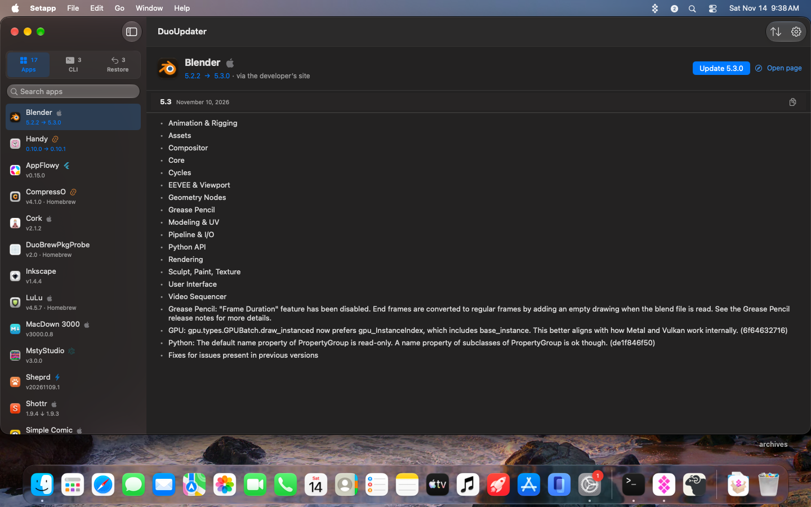
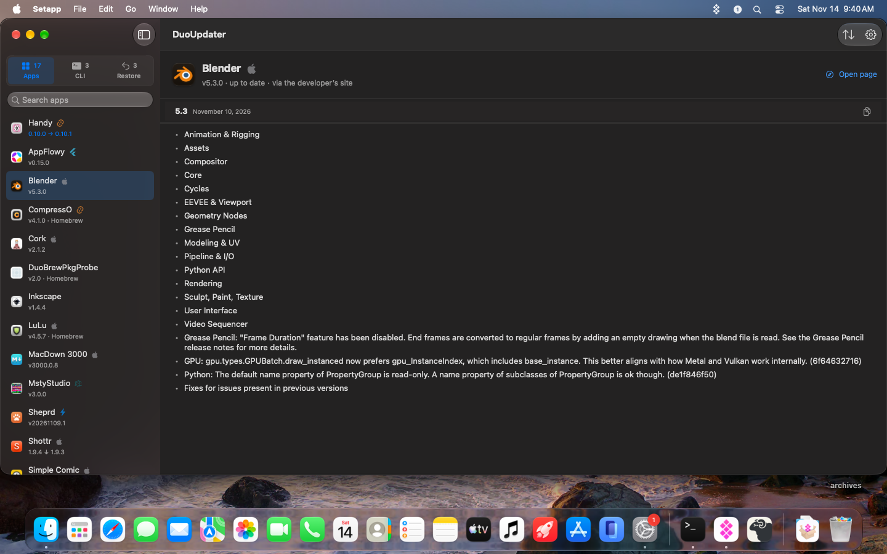

# Blender stable mirror verification (2026-11-15)

Environment: the independent **Duo recipe seven 27.2** VM, macOS 27.2 (26B123), Apple Silicon, 4 CPUs / 8 GB, fixed 1440 × 900 display. The other VM was left alone. No VM or snapshot was deleted or reverted.

The app and CLI were built with Developer ID signing from this PR's production source and installed at `/Applications/DuoUpdater.app` and `~/.local/libexec/duo` in the VM. CLI source digest: `2191c2c10e5ca270a23aa987bce34a8117c736fe7da87a6b6585119cd87b0a47`. The previous VM app, CLI, preferences and official old DMG remain under `~/duo-verify/blender-mirror`.

## Detection: actual red → green

A genuine official **5.2.2** arm64 copy was installed at `/Applications/Blender.app`, after checking both `/Applications` and `~/Applications` for existing copies. It passed strict signature verification, Team `68UA947AUU`.

```sh
duo check /Applications/Blender.app --all --include-hidden --json
# Before (previous build): status "error: HTTP 403", no latest version.
# After (this PR): latestVersion "5.3.0", hasUpdate true,
#                 source "Vendor", route "in-place"; exit 1 means updates available.
```

Raw results: [before](evidence/before.json), [after](evidence/after-check.json).

The host's installed, rebuilt signed CLI also ran `duo verify --only org.blenderfoundation.blender`: **4 ok, 0 warnings, 0 broken, 0 infrastructure failures; beta/RC skipped because their tracks are closed**. Stable and alpha probes, structured changelog and coverage all passed: [log](evidence/host-verify.log), [report](evidence/host-verify.json). The host's Blender installation was not changed.

## One-click install and signing

The installed app's normal **Update 5.3.0** button was clicked. Its production install event records **client app, 5.2.2 → 5.3.0, Vendor, full download 359,893,873 bytes, applied true**: [raw event](evidence/gui-install-events.ndjson). No install or signature gate was bypassed.

`duo verify-install --only vendor:org.blenderfoundation.blender:stable --full --identities <copy of accepted identities.json>` independently downloaded and inspected the official DMG: **1 ok, 0 warnings, 0 failures, 0 unresolved**, `org.blenderfoundation.blender / 68UA947AUU`: [log](evidence/install-verify.log), [report](evidence/install-verify.json).

The final installed bundle reports **5.3.0 / 5.3.0**, passes `codesign --verify --deep --strict`, and is accepted by `spctl` as **Notarized Developer ID**, Team `68UA947AUU`: [versions and signing](evidence/final-version-signature.log). A new CLI check reports **up-to-date**, no update: [final check](evidence/final-check.json).

Blender remains installed at 5.3.0 and is not running. Old archives and backups remain available; the VM was not rolled back.

## Native UI

The installed app renders **5.2.2 → 5.3.0**, the ordinary update button and native structured **5.3 / November 10, 2026** notes. After installation it renders **v5.3.0 · up to date**. These are the real app, not gallery fixtures:





## Checks and limits

- 26 targeted probe/Codable/golden tests passed; only Blender's golden changed.
- Default `make test`: scripts and App passed; the unrelated live `installPipelineDryRun` failed because the installed Kuvo is `run.kuvo.app` while the vendor's new 0.7.2 package is `run.kuvo.code`. The existing identity gate refused it. [Original failure](evidence/known-kuvo-smoke-failure.log).
- `make test CORE_TEST_FLAGS='--skip installPipelineDryRun'`: **all 3 parts passed**, Core 7,471 tests / 660 suites (one existing known issue), CLI 704 tests / 79 suites, plus App and Python gates. [Summary](evidence/make-test-scoped.log).

The change covers current stable release discovery and its existing official installer route. Alpha/beta/RC endpoints and channel detection are unchanged; this run does not claim new preview install validation or a separate LTS-pinning policy.
