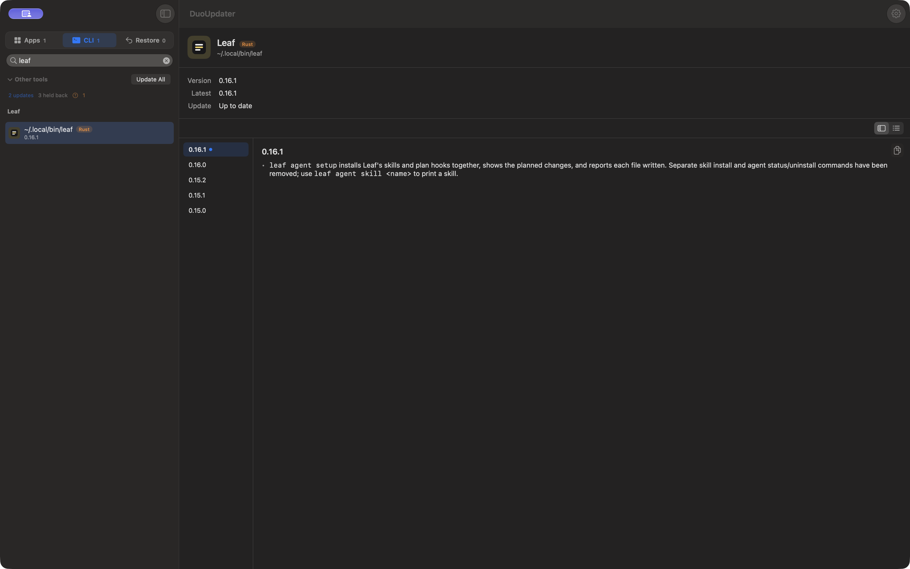

# Leaf CLI integration

Audit date: 2026-11-15. Project: [DeepanshuMishraa/leaf](https://github.com/DeepanshuMishraa/leaf), an MIT-licensed Rust terminal document/diff reader. This is a CLI audit: Leaf does not ship a macOS application bundle or bundle ID. No sunset or end-of-service announcement was found in the vendor README or release workflow; the repository was not archived.

## Distribution and installed-copy groups

- **Standalone release archives / curl installer:** `~/.local/bin/leaf` by default. The installer supports `LEAF_INSTALL_DIR`, and may update an existing executable at its current location. `LeafScanner` scans the default directory, `/usr/local/bin`, and an absolute `LEAF_INSTALL_DIR` inherited by the process; arbitrary custom directories absent from that environment are not discovered. A symlink found there is resolved to its actual binary and deduplicated.
- **Homebrew:** `brew install deepanshumishraa/tap/leaf`. The formula's arm64 and x86_64 archives are the same GitHub assets as direct installs. Detection and updates remain in the existing Homebrew group; `leaf upgrade` itself also refuses Cellar installs. Release notes use Leaf's canonical changelog once the formula metadata resolves to this repository.
- **Cargo:** crate `leaf-reader`, executable `leaf`, normally under `~/.cargo/bin`. Existing Cargo manager support reads its tracker and sparse-index version and preserves installation features when updating. Standalone detection leaves Cargo-owned paths to that manager. The notes resolver uses Leaf's canonical changelog after crates.io resolves the repository.
- **Other managers / app-owned binaries:** Cellar, Nix, mise installs and executables inside `.app` bundles are excluded from standalone self-update. They remain under their owning manager; no attempt is made to replace them as standalone copies.
- **Release range:** the published GitHub release list contained ten stable releases, v0.12.0–v0.16.1, with prebuilt macOS arm64 and x86_64 assets. The first prebuilt release, previous release v0.16.0 and current v0.16.1 were inspected as real archives. Earlier source-built Cargo copies use Cargo's manager route. A standalone version below 0.12.0 is detected if it carries the version marker, but cannot one-click because it predates `leaf upgrade`.
- **Tracks:** the release workflow marks suffix versions as prereleases; none were published in the observed list. `leaf upgrade` accepts only plain `major.minor.patch` versions and leaves installed prereleases alone. The standalone check preserves prerelease suffixes and withholds a stable offer for them. No invented beta/nightly feed or preference binding.

Vendor sources: [installation and update instructions](https://github.com/DeepanshuMishraa/leaf/blob/main/README.md), [release workflow](https://github.com/DeepanshuMishraa/leaf/blob/main/.github/workflows/release.yml), [official formula](https://github.com/DeepanshuMishraa/homebrew-tap/blob/main/Formula/leaf.rb), [upgrader](https://github.com/DeepanshuMishraa/leaf/blob/main/src/upgrade.rs).

## Detection and one-click

The scanner reads the compiled `leaf/<version>` User-Agent without executing the binary, and derives the archive architecture from its Mach-O header. Checks follow `https://github.com/DeepanshuMishraa/leaf/releases/latest` to a stable `vX.Y.Z` tag using a revalidated HEAD request. Version checks and the vendor updater do not call the GitHub API.

One-click is the installed binary's own `leaf upgrade`. It is offered only for a supported macOS architecture, a stable version with that command, a writable destination and a file without quarantine. `LeafVerifier` downloads the installed version's archive, checks its SHA-256 against the vendor's `.tar.gz.sha256` sidecar, extracts it in a temporary directory, and compares the binary hash before execution. A remembered mismatch withholds subsequent offers. After the command, a newer version must be readable and must match its own verified release archive before the result counts as updated. No sudo fallback is introduced.

The vendor stages beside the executable, runs `version` on the staged binary, and renames it over the old file. Open sessions retain their existing inode. Both `leaf upgrade` and its official `leaf update` alias are treated as busy; `--check` is read-only. The command and post-update verification run inside `InstallCommit`, shielding the completed update from cancellation during verification.

The updater reconstructs the exact command and uses a system PATH. It does not run `agent setup`, install hooks, or call plugin installation commands. Leaf itself refreshes already-installed unedited, stamped skills and its existing Rex plugin during startup, including `upgrade` and `version`; this is vendor behavior, not a claim that an update writes only the executable. See [startup dispatch](https://github.com/DeepanshuMishraa/leaf/blob/main/src/main.rs), [skill refresh](https://github.com/DeepanshuMishraa/leaf/blob/main/src/skills.rs) and [plugin refresh](https://github.com/DeepanshuMishraa/leaf/blob/main/src/plugin.rs).

## Structured changelog and icon

Read `CHANGELOG.md` at the selected published tag, not the moving default branch. Plain version sections become native structured entries; `Unreleased` is excluded. A missing file on an older tag falls back to the GitHub Releases parser. This matters for 0.16.1: its release body has only a compare link, whereas its canonical changelog has the actual `leaf agent setup` change.

The CLI icon is the vendor's [favicon.svg](https://github.com/DeepanshuMishraa/leaf/blob/main/site/public/favicon.svg), kept in its original colors. Source and the full MIT notice (Copyright (c) 2026 Deepanshu Mishra) accompany the asset.

## Validation

Automated coverage includes passive scanning and manager ownership, stable/prerelease parsing, malformed redirects, quarantined/read-only/busy gates, changed installed bytes, tampered archives refused before extraction or execution, exact update command reconstruction despite a hostile command payload, successful replacement, unchanged outcomes and post-update hash failure.

### Real-machine result (2026-11-15)

On an Apple Silicon Mac, the signed installed `duo` found a verified v0.12.0 at the real default `~/.local/bin/leaf` path and offered v0.16.1. `duo install <leaf-path> --yes --json` returned:

```json
{"applied":true,"name":"Leaf","outcome":"installed","tool":"leaf","version":"0.16.1"}
```

Its streamed output included `Checking Leaf 0.12.0 against its published SHA-256…` and `Upgraded leaf from 0.12.0 to 0.16.1.` The resulting executable printed `leaf 0.16.1`, and its SHA-256 was `e1284dc2e90ecca8360f3893ea44ac7b23bf9d68c702f649bd11670a0d52ce51`, matching the binary from the verified current archive. A fresh `duo check <leaf-path> --all --json` returned `upToDate`, with installed and latest versions both 0.16.1. The tool remains installed at the latest version.

Observed archive checksums:

- v0.16.0 arm64: `1fbbc5fdaf3d44c996b0a07120f6d8203a5e42e88295c93a42f5b8dea0563636`.
- v0.16.1 arm64: `39f1c05dffee98270fb468045ddcd31d0bd03f6236a6651399683386e5fa0227`.

GUI validation completed on 2026-11-15 after the workbench was opened. In the installed app's CLI tab, the filtered Leaf row shows its official icon, Rust badge and version 0.16.1; the detail pane shows installed/latest versions both 0.16.1 and `Up to date`. The native version rail lists 0.16.1 through 0.15.0, and the selected 0.16.1 entry renders its actual `leaf agent setup` change as a structured bullet, including inline code. The screenshot below captures only DuoUpdater's window with isolated-window capture; it verifies the content and icon in the observed dark appearance, not glass compositing. No production code changed for this follow-up.



The final signed CLI build also updated verified v0.16.0 to v0.16.1 while a v0.16.0 reader stayed open on a temporary Markdown document. Installation returned `applied:true`; a fresh check returned `upToDate` and correctly reported one running process on the replaced binary. The current file again matched the verified v0.16.1 hash. The old reader remained running until it was quit normally with `q`, then exited successfully.

Final local validation: `make test` passed all three parts (Core: 7,498 Swift Testing cases plus XCTest, with one pre-existing known issue; CLI: 704 cases; App: all 365 cases executed; script and localization checks passed). `make install` and `make cli` both completed with Developer ID verification and the macOS 15 runtime-library checks. Independent gpt-6-astra adversarial review on `d645a32266c4dba6f2c6db95676c57820df97ca2` had no remaining findings after the alias, Cargo ownership and exact-command regression fixes.

## 夜扫覆盖

The existing app nightlies do not enumerate standalone CLI providers. `CLI/Sources/DuoKit/Verify.swift` selects the vendor, GitHub, changelog, App Store, feed, MyGo, PKG architecture and app-changelog-coverage registries; it does not enumerate `CLITools.providers()`. `InstallVerify.swift` selects vendor/GitHub app rules and `AuditedUpdateFeeds`; that public inventory accepts only Electron or Sparkle configurations for an `InstalledApp` with a bundle ID. Leaf has neither an app bundle nor one of those feed formats, so no truthful Leaf recipe ID fits those existing routes.

This is an explicit monitoring limitation: Leaf's version, archive and canonical notes are verified by its provider during normal tool checks, one-click verification and the real-path runs above, but are not covered by the app recipe nightlies. No nightly Leaf check is claimed or was run. Supporting standalone CLI providers in a nightly enumerator remains separate work; no synthetic app identity or inactive runtime recipe was added to disguise the gap.
